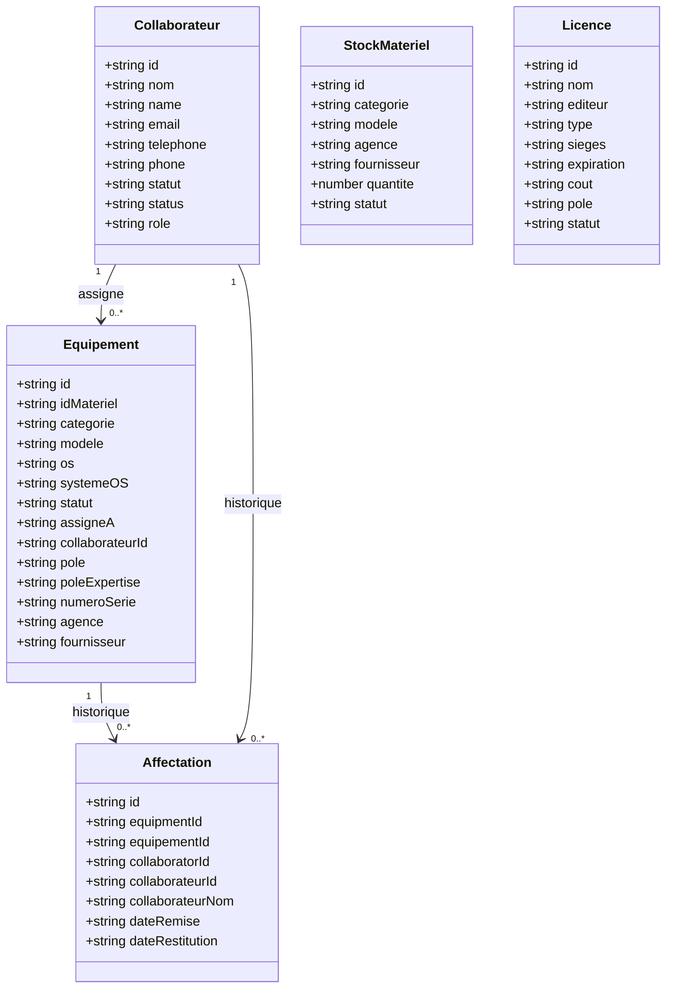
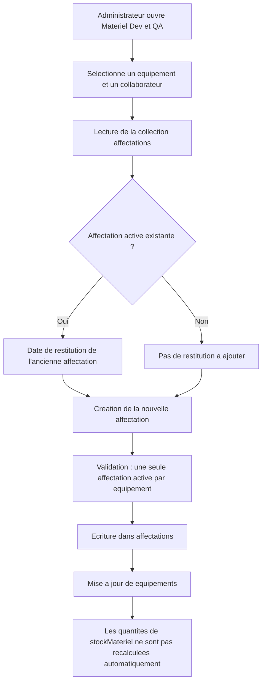
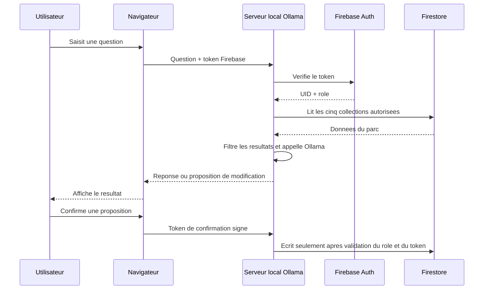

# Modele reel de l'application

Ce document est la source de verite pour remplacer les anciens diagrammes dans le rapport.

## Collections Firestore

Le projet utilise cinq collections :

- `equipements` : une fiche par equipement individuel, y compris les equipements `En stock`.
- `collaborateurs` : fiches des collaborateurs et leur role metier.
- `stockMateriel` : articles regroupes par categorie, modele et agence, avec `quantite` et `statut`.
- `licences` : licences logicielles et suivi des sieges.
- `affectations` : historique des remises et restitutions d'equipements.

`stockMateriel` n'est pas recalcule automatiquement depuis `equipements` dans le code actuel. Il est gere directement par la page Stocks & Licences.

## Diagramme de classes / donnees

## Flux d'affectation reel

## Assistant local

